# INFORME DE LABORATORIO N° 4
# GENERACIÓN DE APLICACIONES FULL-STACK CON INTELIGENCIA ARTIFICIAL (LIBROYA)

**Universidad de Antioquia**  
**Facultad de Ingeniería — Departamento de Ingeniería de Sistemas**  
**Curso:** Fundamentos de Sistemas de Información (2026)  
**Profesor:** Diego José Luis Botia V.  
**Estudiante:** Santiago Jaramillo  
**Fecha:** 25 de noviembre de 2026  
**Repositorio GitHub:** [https://github.com/Santiagox01/lab4](https://github.com/Santiagox01/lab4)  
**Frontend desplegado (Railway):** [https://lab4-production-052fb297.up.railway.app](https://lab4-production-052fb297.up.railway.app)  
**Backend desplegado (Railway):** [https://server-production-75813d16.up.railway.app/health](https://server-production-75813d16.up.railway.app/health)

---

## 1. RESUMEN EJECUTIVO

El presente informe documenta el diseño, construcción iterativa, auditoría de seguridad, despliegue en la nube y verificación funcional del **Laboratorio N° 4**, aplicando ingeniería asistida por Inteligencia Artificial con revisión arquitectónica continua (sin aceptar cambios a ciegas). Siguiendo los entregables especificados en la Sección 13 de la guía, se construyó **LibroYa**, una aplicación web full-stack de comercio electrónico para la **venta de libros electrónicos (eBooks, PDF, Audiolibros y ediciones impresas + eBook), gestión de catálogo y stock, pasarela de pago verificada en PayPal Sandbox y gestión/seguimiento de envíos en tiempo real**.

La arquitectura desacopla por completo la interfaz de usuario del servidor de negocio:
- **Frontend (`web/`):** Next.js 15 (App Router), React 19, TypeScript y Tailwind CSS, responsable exclusivamente de la experiencia de usuario y del carrito local, sin rutas API internas ni credenciales secretas.
- **Backend (`server/`):** Node.js, Express, TypeScript, Mongoose y Socket.IO en un único proceso persistente encargado de autenticación JWT, control de acceso basado en roles (`cliente` y `administrador`), recálculo autoritativo de importes, integración OAuth2/Orders v2 con PayPal Sandbox, máquina de estados explícita para despachos y difusión en vivo vía WebSockets.
- **Persistencia en la nube:** MongoDB Atlas (`libroya`), con colecciones `users`, `books`, `orders` y `payments`.
- **Despliegue y pruebas:** Servicios separados en Railway (`/server` y `/web`), suite de pruebas automatizadas en backend (**Vitest + Supertest + MongoMemoryServer + Socket.IO Client**, 8/8 suites aprobadas) y evaluación E2E en la nube con **TestSprite** (`Live Web App` guiada por `PRD.md`), logrando corregir un defecto visual real detectado por la suite (`CATALOG-003`).

---

## 2. INTRODUCCIÓN Y ARQUITECTURA DE REFERENCIA

### 2.1. Separación Frontend/Backend y Límites de Confianza
La generación de software asistida por IA exige definir previamente contratos de datos, responsabilidades y límites de confianza para evitar vulnerabilidades frecuentes (como validar precios o confirmar pagos desde el navegador). En **LibroYa**:
1. **El navegador nunca decide precios ni estados pagados:** Al confirmar una compra, el frontend envía exclusivamente identificadores de libros (`bookId`), cantidades enteras (`quantity`), dirección de entrega y método de envío (`DIGITAL_INSTANT`, `STANDARD` o `EXPRESS`). El servidor consulta los precios unitarios y el inventario vigente en MongoDB Atlas y recalcula `subtotal`, `shippingCost` y `total`.
2. **Validación en backend de PayPal Sandbox:** Solo el servidor posee `PAYPAL_CLIENT_SECRET`. Tras la aprobación del comprador en el SDK de PayPal, el cliente invoca `POST /api/payments/paypal/capture`, donde el backend consulta directamente a PayPal v2 Orders API, verifica `status === "COMPLETED"`, moneda `USD`, importe coincidente y `custom_id`, descuenta el inventario de forma atómica y promueve el pedido a `PAID`.
3. **WebSockets en el mismo proceso del backend:** Al alojar **Socket.IO** dentro del servidor Express (`server/src/socket/io.ts`), cada mutación de pago, cambio de estado logístico o ajuste de stock emite notificaciones autenticadas en milisegundos sin requerir consultas continuas (*polling*) ni infraestructura de mensajería adicional.

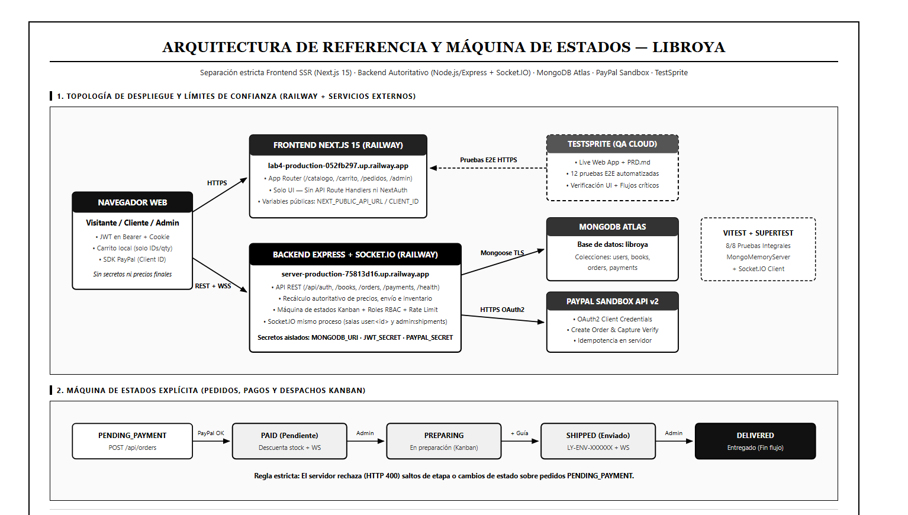

### 2.2. Estructura del Monorepo
```text
lab4/
├── package.json              # Scripts globales (dev, build, test, seed)
├── .gitignore                # Excluye .env, .env.local, node_modules, dist, .next
├── .env.example              # Referencia raíz sin secretos
├── PRD.md                    # Requisitos funcionales y criterios para TestSprite
├── README.md                 # Documentación técnica y guía Railway
├── server/                   # Backend Express + Mongoose + Socket.IO + PayPal
│   ├── railway.json          # Build/start y healthcheck /health
│   ├── .env.example          # Plantilla de variables backend
│   └── src/
│       ├── config/           # Carga de entorno (env.ts) y conexión Atlas (db.ts)
│       ├── models/           # User, Book, Order, Payment
│       ├── middleware/       # JWT auth, requireRole, rateLimit, errorHandler
│       ├── services/         # orderStateMachine.ts, paypalService.ts
│       ├── socket/           # RealtimeHub (Socket.IO autenticado)
│       ├── routes/           # auth, books, orders, payments
│       ├── seed/             # Carga idempotente de usuarios demo, 10 libros y 2 pedidos
│       └── __tests__/        # Suite integral Vitest (api.test.ts)
└── web/                      # Frontend Next.js 15 App Router (solo UI)
    ├── railway.json          # Build/start Next.js en 0.0.0.0:$PORT
    ├── .env.example          # Solo NEXT_PUBLIC_API_URL y NEXT_PUBLIC_PAYPAL_CLIENT_ID
    ├── public/covers/        # 10 portadas editoriales SVG locales
    └── src/
        ├── app/              # /, /catalogo, /login, /registro, /carrito, /checkout/[orderId], /pedidos, /admin
        ├── components/       # Navbar, BookCard, BookDetailModal, PayPalCheckout, KanbanBoard, CatalogAdminPanel
        ├── context/          # AuthContext, CartContext
        └── lib/              # api.ts, socket.ts, types.ts
```

---

## 3. MODELO DE DATOS, MÁQUINA DE ESTADOS Y CONTRATO DE API

### 3.1. Colecciones en MongoDB Atlas (`libroya`)
| Colección | Campos principales | Reglas de integridad y seguridad |
|---|---|---|
| `users` | `name`, `email`, `passwordHash`, `role`, `createdAt`, `updatedAt` | `role ∈ {cliente, administrador}`; registro público asigna siempre `cliente`; `passwordHash` cifrado con `bcryptjs` (cost 10), `select: false` y omitido en `toJSON`. |
| `books` | `title`, `author`, `isbn`, `description`, `category`, `format`, `price`, `stock`, `available`, `coverUrl`, `pages`, `language`, `publishedYear` | `isbn` único; `price > 0`; `stock` entero `>= 0`; índice compuesto `{ category: 1, format: 1, available: 1 }`. |
| `orders` | `orderNumber`, `userId`, `items[]`, `shippingAddress`, `shippingMethod`, `shippingCost`, `trackingCode`, `subtotal`, `total`, `status`, `paymentStatus`, `paypalOrderId`, `paidAt`, `shippedAt`, `deliveredAt` | `items` guarda snapshot histórico (`unitPrice`, `title`, `format`, `quantity`, `subtotal`); totales recalculados exclusivamente en backend. |
| `payments` | `orderId`, `userId`, `provider`, `providerOrderId`, `captureId`, `amount`, `currency`, `status`, `payerEmail` | Nunca almacena datos de tarjeta; índices únicos dispersos en `providerOrderId` y `captureId` para evitar capturas duplicadas. |

### 3.2. Máquina de Estados Explícita (`orderStateMachine.ts`)
Para impedir saltos ilegales desde la interfaz o manipulaciones directas de la API, el servidor gobierna las transiciones mediante la tabla `ADMIN_ALLOWED_TRANSITIONS`:
- **Flujo de pedido y despacho:**
  `PENDING_PAYMENT` $\xrightarrow{\text{PayPal CAPTURED}}$ `PAID` (Pendiente) $\xrightarrow{\text{Admin}}$ `PREPARING` (En preparación) $\xrightarrow{\text{Admin + guía}}$ `SHIPPED` (Enviado) $\xrightarrow{\text{Admin}}$ `DELIVERED` (Entregado).
- **Flujo de pago:**
  `PENDING` $\rightarrow$ `CREATED` $\rightarrow$ `CAPTURED` (o `FAILED` / `CANCELLED` con posibilidad de reintento sin duplicar la orden).
- **Restricciones activas:** El endpoint `PATCH /api/orders/:id/status` rechaza con **HTTP 400** cualquier intento de mover un pedido `PENDING_PAYMENT` o saltar directamente de `PAID` a `DELIVERED`. Al pasar a `SHIPPED`, si el administrador no digita código de guía, el servidor genera automáticamente `LY-ENV-<6 dígitos>`.

### 3.3. Endpoints REST Documentados y Control de Acceso
| Método y Ruta | Propósito | Control de acceso |
|---|---|---|
| `GET /health` | Estado de API y conexión Atlas | Público; no expone secretos ni URIs |
| `POST /api/auth/register` | Crear cuenta de cliente | Público (rate-limited); fuerza `role: "cliente"` |
| `POST /api/auth/login` | Autenticar usuario y emitir JWT | Público (rate-limited); error genérico `401` |
| `POST /api/auth/logout` | Limpiar cookie de sesión | Público |
| `GET /api/auth/me` | Obtener perfil de sesión | Autenticado (`401` sin JWT) |
| `GET /api/books` | Consultar catálogo y filtros | Público (`category`, `format`, `search`, `inStock`) |
| `GET /api/books/:id` | Detalle de un título | Público |
| `POST /api/books` | Crear nuevo libro | Solo `administrador` (`403` para clientes) |
| `PATCH /api/books/:id` | Editar libro / disponibilidad | Solo `administrador`; emite `stock:updated` |
| `PATCH /api/books/:id/stock` | Ajuste de inventario (`stock` o `delta`) | Solo `administrador`; rechaza stock `< 0`; emite `stock:updated` |
| `DELETE /api/books/:id` | Eliminar libro del catálogo | Solo `administrador` |
| `POST /api/orders` | Crear orden `PENDING_PAYMENT` | Autenticado; valida stock y recalcula totales |
| `GET /api/orders/me` | Historial del cliente autenticado | Autenticado; filtra por `userId === req.user.id` |
| `GET /api/orders` | Listar pedidos pagados para Kanban | Solo `administrador` |
| `GET /api/orders/:id` | Consultar orden específica | Propietario o `administrador` (`403` otros) |
| `PATCH /api/orders/:id/status` | Avanzar estado en Kanban | Solo `administrador`; aplica máquina de estados y emite WS |
| `POST /api/payments/paypal/order` | Crear orden en PayPal Sandbox | Propietario del pedido; revalida stock |
| `POST /api/payments/paypal/capture` | Capturar y confirmar compra | Propietario; idempotente; descuenta stock atómicamente |
| `POST /api/payments/paypal/cancel` | Registrar cancelación en PayPal | Propietario; mantiene `PENDING_PAYMENT` para reintento |

### 3.4. Eventos WebSocket (`Socket.IO`)
El servidor valida el JWT durante el handshake (`auth.token`, header `Authorization` o cookie `libroya_token`) y asigna las salas en el servidor (nunca desde el navegador):
- `user:<id>`: todos los usuarios autenticados; recibe `order:updated` y `order:statusChanged` únicamente de sus propios pedidos (solo ciudad/país, sin exponer dirección completa a terceros).
- `admin:shipments`: exclusivo para `role === "administrador"`; recibe `order:created` al confirmarse un pago y `order:statusChanged` ante actualizaciones del tablero.
- `stock:updated`: broadcast de `{ bookId, stock, available }` para mantener sincronizado el catálogo y los tope máximos del carrito.

---

## 4. SEGURIDAD, PASARELA PAYPAL SANDBOX Y CONTROL DE STOCK

Siguiendo la lista de auditoría de seguridad (Sección 12.2 de la guía), se verificaron los siguientes controles antes y después del despliegue:

1. **Gestión estricta de secretos:** Las variables `MONGODB_URI`, `JWT_SECRET` y `PAYPAL_CLIENT_SECRET` existen únicamente en `server/.env` (excluido por `.gitignore`) y en las variables privadas del servicio `server` en Railway. El frontend solo conoce `NEXT_PUBLIC_API_URL` y `NEXT_PUBLIC_PAYPAL_CLIENT_ID`. El escaneo sobre los 72 archivos rastreados del repositorio arrojó **0 filtraciones**.
2. **Idempotencia de pagos y protección de inventario:** Al capturar un pago en `/api/payments/paypal/capture`, si la orden o el documento `Payment` ya figuran en estado `CAPTURED`, el backend responde inmediatamente `200 { idempotent: true }` sin volver a invocar la API de PayPal ni descontar stock por segunda vez. En capturas nuevas, el inventario se decrementa de forma atómica por libro (`Book.findOneAndUpdate({ _id, available: true, stock: { $gte: quantity } }, { $inc: { stock: -quantity } })`); si cualquier ítem del lote no tiene stock por concurrencia, el servidor revierte los descuentos previos y responde `409 Conflict`.
3. **Hardening HTTP y validación de entrada:** `helmet()` en cabeceras, CORS restringido exactamente a `CLIENT_ORIGIN`, límite de tasa (`express-rate-limit`) en `/api/auth/login` y `/api/auth/register`, validación estricta de esquemas con `zod` y escape de metacaracteres en búsquedas textuales con expresiones regulares para prevenir ataques ReDoS.

---

## 5. DESPLIEGUE EN LA NUBE (MONGODB ATLAS Y RAILWAY)

### 5.1. Configuración de Servicios
- **Base de datos (`MongoDB Atlas`):** Clúster `xius` con base de datos `libroya` y usuario exclusivo de aplicación. Poblado inicialmente con `npm --prefix server run seed` (2 cuentas demo ficticias `cliente@libroya.com` y `admin@libroya.com`, 10 libros electrónicos incluyendo títulos de stock bajo `3` y agotado `0`, y 2 pedidos iniciales para validar historial y Kanban).
- **Servicio Backend (`server` en Railway):** Root Directory `/server`, compilación `npm install && npm run build`, arranque `npm start` escuchando en `0.0.0.0:$PORT`, y *healthcheck* automático en `/health`.
- **Servicio Frontend (`web` en Railway):** Root Directory `/web`, compilación `npm install && npm run build` (con variables públicas configuradas antes del build), arranque `npm start` (`next start -H 0.0.0.0`).

### 5.2. Incidencias Encontradas y Resueltas Durante el Despliegue
| Incidencia observada | Causa raíz diagnosticada | Solución aplicada y verificada |
|---|---|---|
| `language override unsupported: Español` al ejecutar el seed en Atlas | MongoDB reserva el campo `language` para el idioma de tokenización en índices `text` (`title/author/description`). | Se reemplazó el índice `text` por `{ category: 1, format: 1, available: 1 }` en `Book.ts` y se sincronizaron índices con `Book.syncIndexes()`. |
| `[BOOTSTRAP ERROR] Could not connect to any servers in your MongoDB Atlas cluster` en Railway | *Network Access* de Atlas solo autorizaba la IP local de desarrollo y bloqueaba las IPs dinámicas de salida de Railway. | Se autorizó acceso controlado en Atlas *Network Access* y se redesplegó `server`, confirmando `"db": "connected"` en `/health`. |
| `Error de solicitud (404)` al abrir el frontend desplegado | `NEXT_PUBLIC_API_URL` fue ingresada inicialmente sin prefijo `https://`, haciendo que `fetch` apuntara a rutas inexistentes dentro de Next.js. | Se corrigió a `https://server-production-75813d16.up.railway.app` (y `CLIENT_ORIGIN` en `server` a `https://lab4-production-052fb297.up.railway.app`) y se redesplegó `web`. |

---

## 6. ESTRATEGIA DE PRUEBAS (`PRD.md`, VITEST Y TESTSPRITE)

### 6.1. Suite Automatizada de Backend (`Vitest + Supertest + Socket.IO`)
Se implementaron **8 suites integrales** en `server/src/__tests__/api.test.ts` ejecutadas contra `mongodb-memory-server`, un gateway mockeado de PayPal y clientes reales de `socket.io-client`. Todas (**8/8 — 100%**) pasaron tras la compilación final:
1. `GET /health` y catálogo público sin sesión con filtros por categoría y disponibilidad.
2. Registro con rol forzado a `cliente` (bloquea escalada a `administrador`), hash `bcrypt` y ocultamiento de `passwordHash`.
3. Bloqueo de rutas protegidas para anónimos (`401`) y rechazo `403` para clientes sobre consola admin y stock.
4. Recálculo autoritativo de precios/envío en servidor (ignora `unitPrice`/`total` manipulados) y rechazo `400`/`409` por cantidades negativas, direcciones vacías o stock insuficiente.
5. Aislamiento por propiedad entre clientes (`403` al consultar o intentar pagar pedido ajeno).
6. Flujo PayPal completo: cancelación controlada sin descuento de stock, rechazo `400` ante discrepancia de importe, captura verificada con descuento atómico e idempotencia (`idempotent: true` con una sola llamada a captura).
7. Máquina de estados Kanban (`PAID -> PREPARING -> SHIPPED -> DELIVERED`), rechazo `400` ante saltos ilegales o pedidos no pagados, generación de guía y ajuste de stock administrativo.
8. WebSockets autenticados: rechazo de handshake sin JWT, entrega en tiempo real de `order:created` al admin y `order:updated` / `order:statusChanged` exclusivamente al cliente propietario (0 fugas a terceros).

### 6.2. Resultados de Pruebas Funcionales en Vivo con TestSprite
Se cargó `PRD.md` en **TestSprite** bajo modalidad **Live Web App** (`Frontend UI`) sobre `https://lab4-production-052fb297.up.railway.app` con cuenta de prueba `cliente@libroya.com`. En la ejecución **`Run: Nov 25, 12:52 AM`** (ID `0ca656c3-b327-4107-b461-a46cc7c60593`) se obtuvieron los siguientes resultados:

- **Tasa de éxito inicial:** **83%** (`10` aprobadas · `2` fallidas · `0` bloqueadas · `12` totales).

| ID | Caso de Prueba (TestSprite) | Categoría | Estado | Observación / Diagnóstico |
|---|---|---|---|---|
| `CATALOG-001` | Text search filters the catalog by author, title and ISBN | Catalog | **Failed** | **Falso positivo (Test problem):** Búsqueda por autor, título, ISBN, sin resultados y `"Limpiar filtros"` funcionaron; la aserción final no scrolleó para ver el último libro del catálogo. |
| `CATALOG-002` | Category, format and "Solo con stock" filters narrow the catalog | Catalog | **Passed** | Filtros combinados coherentes con disponibilidad real. |
| `CATALOG-003` | Sold-out books block purchase and low-stock books show a warning | Catalog | **Failed** | **Defecto real UI (Prioridad Alta):** El badge largo `"Edición Impresa + eBook"` en `top-3` solapaba el aviso de stock en `top-3` y ocultaba el número (`"Últimas uds."` en vez de `"Últimas 3 uds."`). **Corregido.** |
| `CATALOG-004` | Book details modal shows full data and adds the book to the cart | Catalog | **Passed** | Modal despliega metadatos completos y añade correctamente al carrito. |
| `CART-SHIPPI-001` | Cart recalculates subtotal and total for quantities and shipping methods | Cart & shipping | **Passed** | Cálculo exacto de subtotal y tarifas de envío. |
| `CART-SHIPPI-002` | Cart quantity cannot exceed the available stock | Cart & shipping | **Passed** | Tope máximo respetado según stock del backend. |
| `ORDERS-CH-001` | Confirming the cart creates a pending order with a server-calculated checkout | Orders & checkout | **Passed** | Orden creada con total recalculado y vista checkout operativa. |
| `ORDERS-CH-002` | Order cannot be confirmed without a delivery address | Orders & checkout | **Passed** | Validación bloquea direcciones vacías. |
| `ORDERS-CH-003` | A pending order can be reopened from My orders to retry payment | Orders & checkout | **Passed** | Recuperación fluida desde `/pedidos` hacia `/checkout/[orderId]`. |
| `ACCESS-ROL-001` | Customer opening the admin console sees an access-denied screen | Access & roles | **Passed** | Pantalla `Acceso denegado (403)` verificada para rol cliente. |
| `ACCESS-ROL-002` | Sign-in with wrong credentials shows the generic error | Access & roles | **Passed** | Mensaje seguro `"Credenciales inválidas."`. |
| `NAVIGATION-001` | Reloading internal pages keeps the page and the session | Navigation & session | **Passed** | Persistencia de rutas y sesión JWT tras recarga. |

### 6.3. Corrección del Defecto `CATALOG-003` y Decisión de Liberación
- **Corrección implementada (`commit 4562259`):** En `web/src/components/BookCard.tsx`, se reubicó la insignia de stock a la esquina inferior derecha (`bottom-3 right-3`) con `whitespace-nowrap`, `data-testid="stock-badge"` y renderizado en un único nodo de texto ``{`Últimas ${book.stock} uds.`}``, evitando colisión visual con formatos extensos como `"Edición Impresa + eBook"`. Se compiló (`npm --prefix web run build`), se subió a GitHub y se verificó visualmente en el despliegue actualizado de Railway (ver Figura `02_catalogo_completo.png`).
- **Limitaciones conocidas:** La ejecución automatizada en TestSprite cubrió el entorno `default` (`cliente@libroya.com`), quedando la captura interactiva dentro del popup externo de PayPal y el tablero Kanban administrativo verificados mediante la suite Vitest (8/8) y pruebas autenticadas directas en el entorno desplegado de Railway.
- **Decisión de liberación:** **Aprobada para entrega académica**, con 100% de pruebas de backend aprobadas, defecto UI crítico resuelto y verificado en producción y 0 secretos expuestos.

---

## 7. EVIDENCIA FOTOGRÁFICA DEL SISTEMA DESPLEGADO

### 7.1. Página Principal Pública (`/`)
Presentación de LibroYa en Railway con acceso directo al catálogo, inicio de sesión, registro y títulos destacados cargados desde MongoDB Atlas.

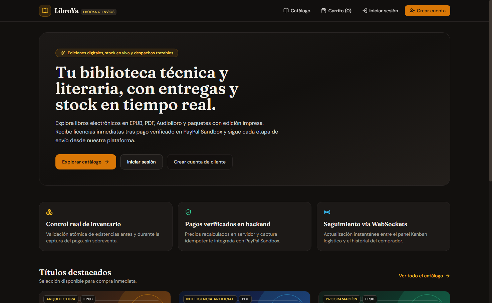

---

### 7.2. Catálogo Público con Corrección `CATALOG-003` Verificada (`/catalogo`)
Visualización del catálogo en vivo tras el despliegue del commit `4562259`. Se observa claramente la insignia `"Últimas 3 uds."` en la esquina inferior derecha de *MongoDB Atlas y Modelado Orientado a Eventos* sin solaparse con `"Edición Impresa + eBook"`, junto con las insignias `"Stock: 16"`, `"Stock: 9"` y el inicio de *Algoritmos del Sur* (`Edición Impresa + eBook`).

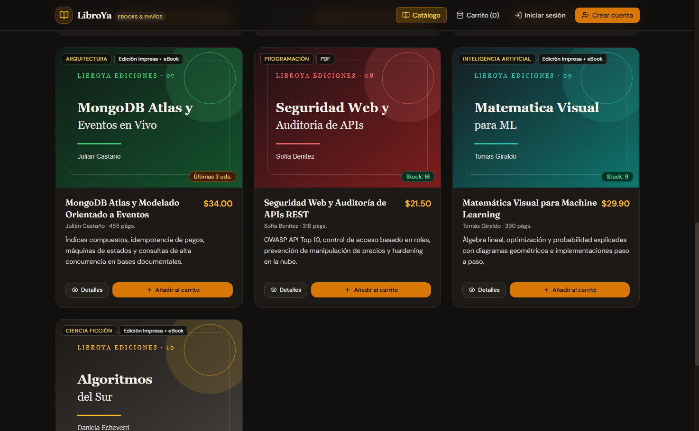

---

### 7.3. Filtros por Categoría y Modal de Detalles del Libro
Filtrado reactivo por categoría `Arquitectura` junto con el modal de especificaciones técnicas (ISBN, páginas, idioma, año y stock disponible).

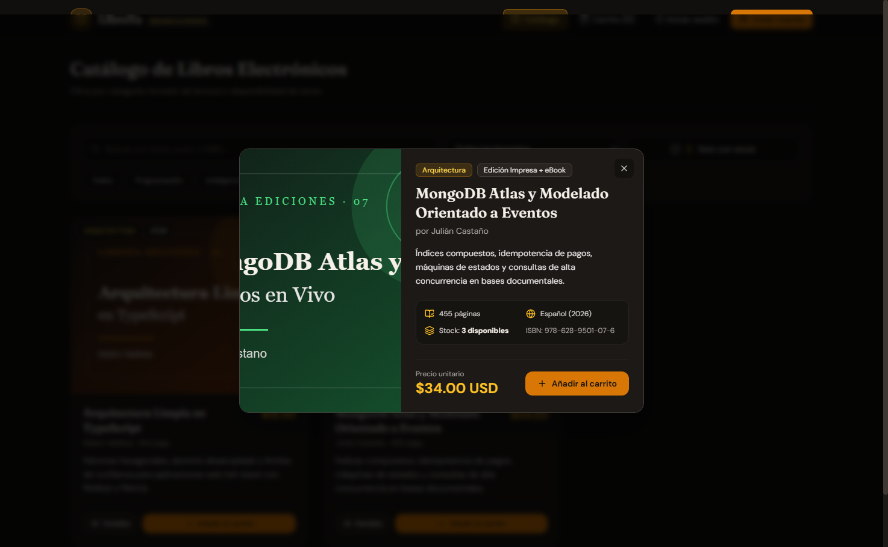

---

### 7.4. Inicio de Sesión (`/login`)
Formulario de autenticación con verificación JWT y panel de cuentas Sandbox de demostración diferenciadas por rol.

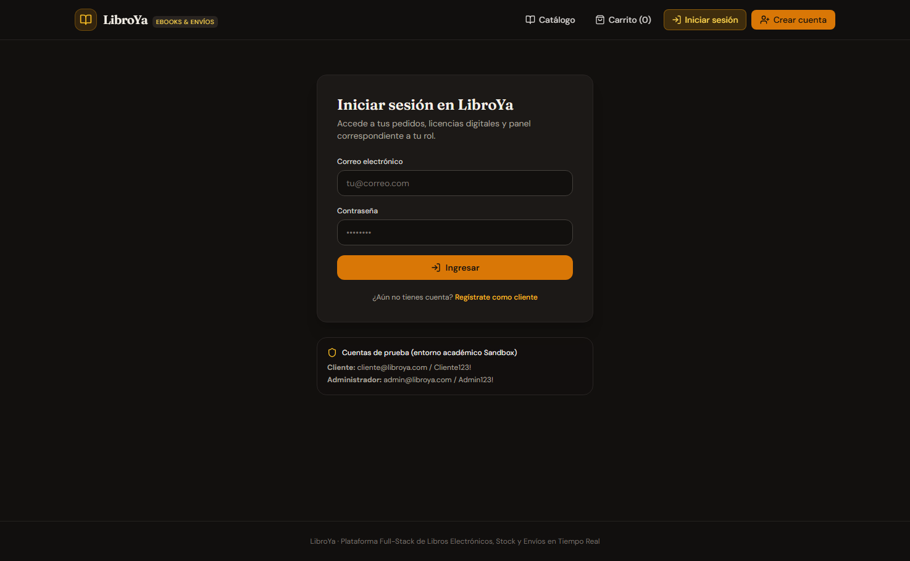

---

### 7.5. Carrito de Compras, Modalidad de Envío y Dirección (`/carrito`)
Gestión de cantidades limitada por stock real, selección de modalidad de entrega (`Digital Instantáneo`, `Estándar`, `Express`) y formulario de dirección validado antes de enviar `POST /api/orders`.

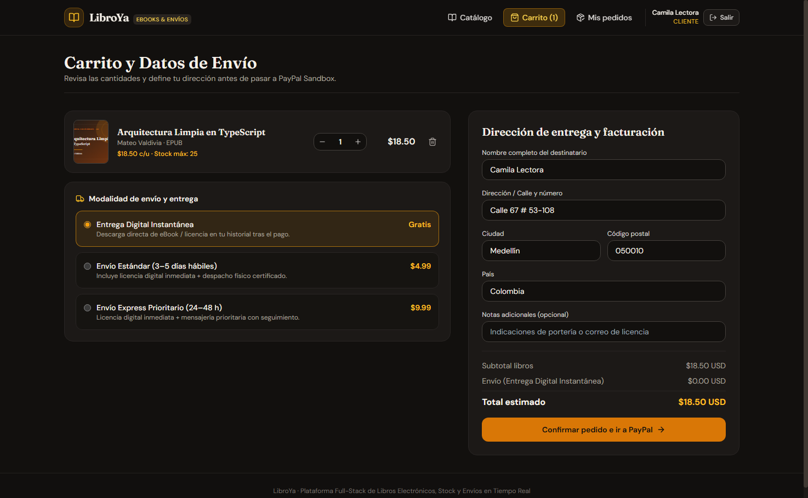

---

### 7.6. Checkout Seguro y Pasarela PayPal Sandbox (`/checkout/[orderId]`)
Vista autoritativa donde el total es recalculado por el backend y se renderizan los botones oficiales del SDK de **PayPal Sandbox** listos para aprobación y captura verificada en el servidor.

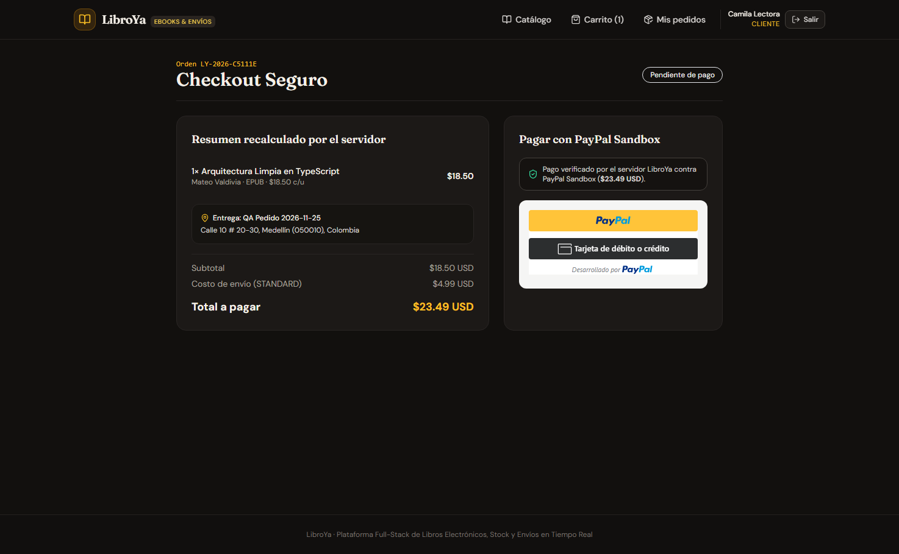

---

### 7.7. Historial del Cliente y Seguimiento en Tiempo Real (`/pedidos`)
Lista de pedidos exclusivos del usuario autenticado mostrando el indicador `"En vivo"` (conexión WSS Socket.IO activa), barra de progreso por etapas (`Pendiente -> En preparación -> Enviado -> Entregado`) y descarga de certificado de licencia digital.

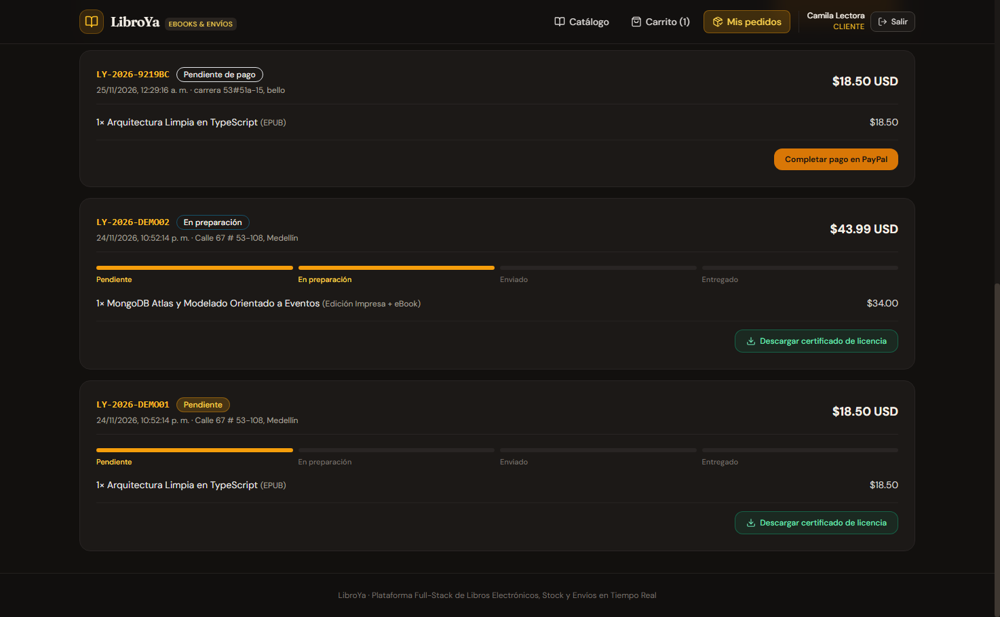

---

### 7.8. Control de Acceso por Roles: Bloqueo a Cliente (`/admin`)
Evidencia de protección en interfaz y servidor: al ingresar un usuario con rol `cliente` a `/admin`, el sistema deniega el acceso mostrando `Acceso denegado (403)`.

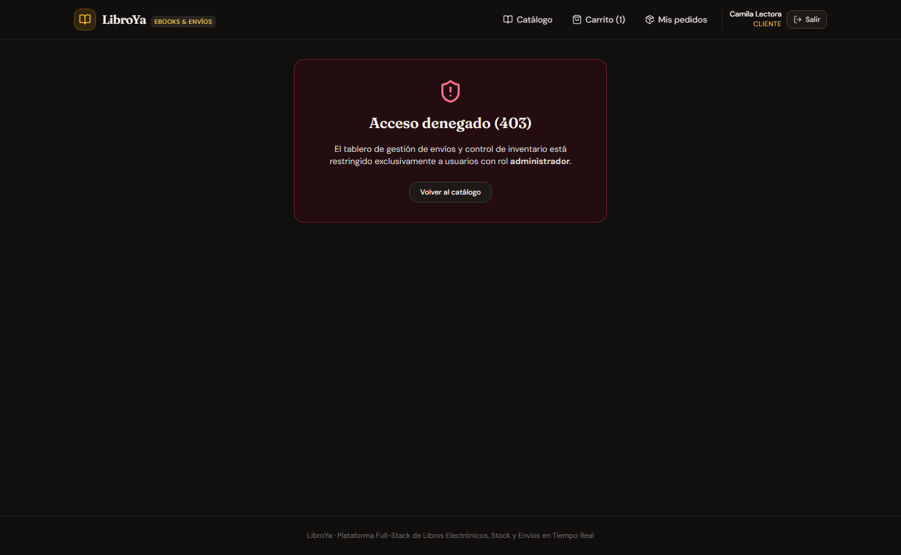

---

### 7.9. Consola de Administración: Tablero Kanban de Envíos (`/admin`)
Vista exclusiva del rol `administrador` conectada en tiempo real a la sala `admin:shipments` (`En vivo`), con las cuatro columnas del flujo logístico (`Pendiente`, `En preparación`, `Enviado` con asignación de guía y `Entregado`).

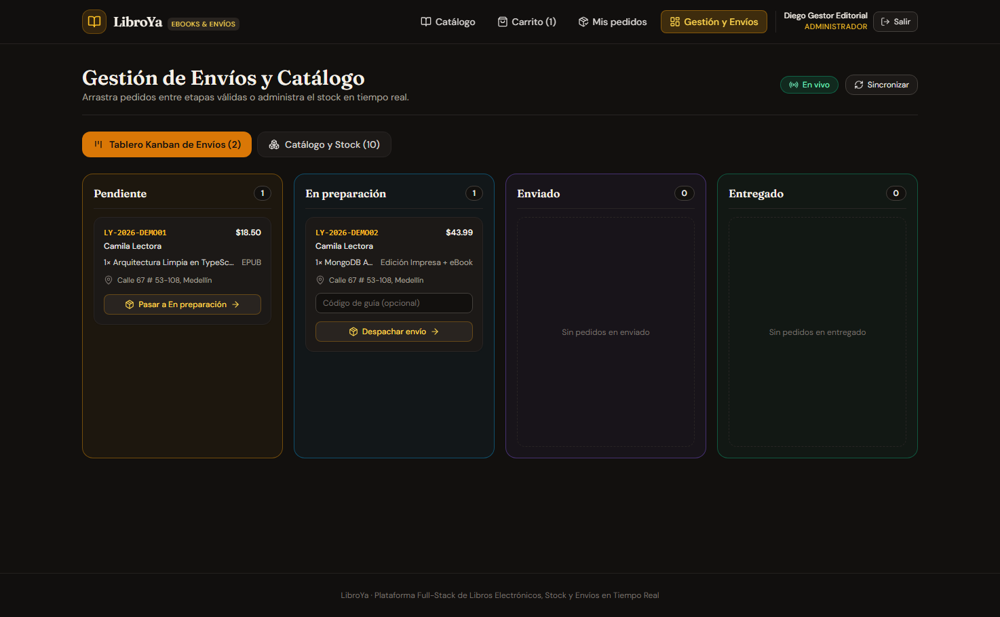

---

### 7.10. Consola de Administración: Gestión de Catálogo y Stock (`/admin`)
Panel de inventario en vivo con métricas agregadas (`Total títulos`, `Stock bajo`, `Agotados`), controles rápidos `-1 / +1 / +5`, pausado/activación de títulos y creación de nuevos libros.

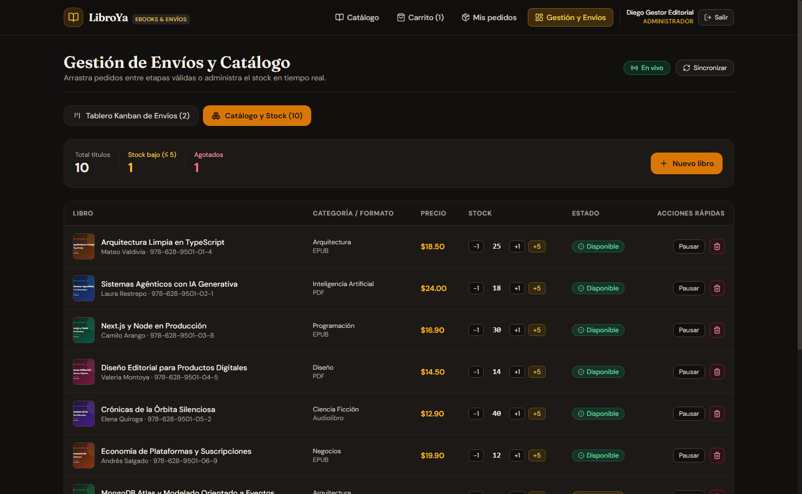

---

### 7.11. Verificación de Disponibilidad del Backend (`/health`)
Respuesta pública en vivo de `https://server-production-75813d16.up.railway.app/health` confirmando servicio operativo y conexión estable a MongoDB Atlas (`"db": "connected"`) sin exponer secretos.

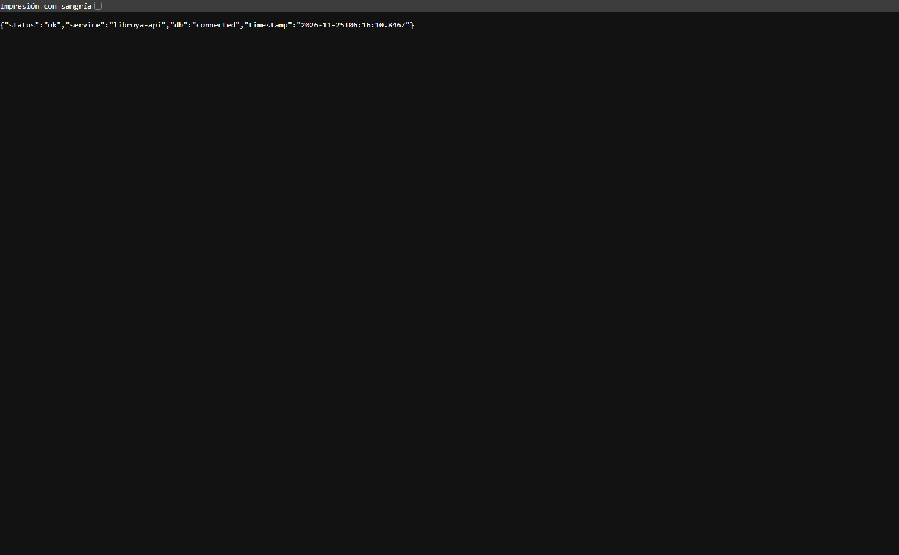

---

### 7.12. Evidencia de Ejecución en TestSprite (`Live Web App`)
Panel de resultados de **TestSprite** (`Run: Nov 25, 12:52 AM`) mostrando el resumen de ejecución (`83% Pass Rate`, `10 Passed`, `2 Failed`, `0 Blocked`, `12 Total`) y el diagnóstico que originó la corrección de `CATALOG-003`.

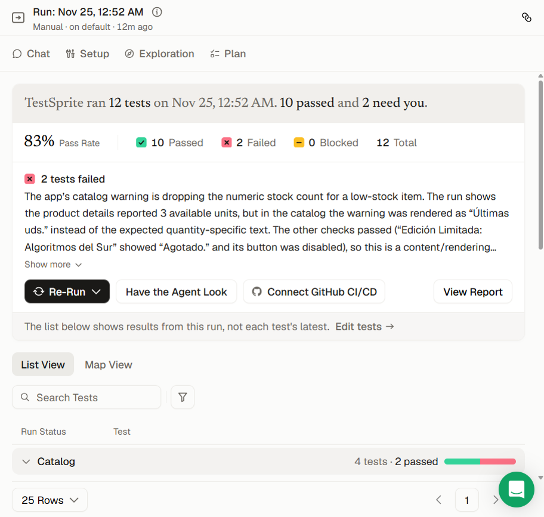

---

## 8. REFLEXIÓN INDIVIDUAL

- **Qué generó la IA:** La Inteligencia Artificial aceleró la estructuración inicial del monorepo (`server/` y `web/`), la escritura de esquemas Mongoose con Zod, el diseño de las vistas responsive en Tailwind CSS, la generación de portadas vectoriales locales, la suite de pruebas en Vitest y la redacción de `PRD.md` y `README.md`.
- **Qué verificó manualmente el equipo:** Se auditó que ninguna credencial privada (`MONGODB_URI`, `JWT_SECRET`, `PAYPAL_CLIENT_SECRET`) quedara en `web/`, `NEXT_PUBLIC_*`, `PRD.md` ni en el historial de Git; se comprobó la conexión real contra MongoDB Atlas, la creación real de órdenes en PayPal Sandbox, la ejecución completa de los 8 tests de backend y la reproducción manual de los fallos reportados por TestSprite antes y después del despliegue en Railway.
- **Decisiones tomadas manualmente:**
  1. Reemplazar el dominio de ejemplo (*PlatoYa*) por el comercio electrónico de libros electrónicos, gestión de catálogo/stock y envíos (**LibroYa**) conforme a la Sección 13 de la guía.
  2. Enviar el JWT por `Authorization: Bearer` además de cookie `httpOnly` para garantizar compatibilidad entre subdominios distintos en Railway sin depender de cookies de terceros.
  3. Sustituir el índice `text` por defecto de MongoDB por un índice compuesto para evitar el choque con el campo `language: "Español"`.
  4. Reubicar la insignia de stock en `BookCard.tsx` tras el hallazgo `CATALOG-003` de TestSprite, priorizando legibilidad en tarjetas con formatos extensos.

---

## 9. CONCLUSIONES Y REFERENCIAS BIBLIOGRÁFICAS

### Conclusiones
1. El trabajo guiado por arquitectura previa y límites de confianza permitió entregar una aplicación full-stack segura donde las operaciones críticas (precios, inventario, captura de PayPal, roles y transiciones logísticas) residen íntegramente en el backend.
2. La integración conjunta de **Express + Socket.IO + MongoDB Atlas + PayPal Sandbox** demostró cómo mantener sincronizados en tiempo real el inventario del catálogo, el historial del comprador y el tablero Kanban administrativo sin recurrir a *polling*.
3. Combinar pruebas de integración deterministas en backend (**Vitest 8/8**) con pruebas E2E en la nube (**TestSprite**) resultó altamente complementario: TestSprite detectó un problema real de superposición visual (`CATALOG-003`) que no era visible en pruebas de API puras.

### Referencias Bibliográficas
1. **Guía de Laboratorio UdeA (2026):** *Generación de aplicaciones con inteligencia artificial (Fundamentos en S.I.)*. Profesor Diego José Luis Botia. Universidad de Antioquia.
2. **Next.js Documentation:** *App Router Architecture and Production Deployment*. Recuperado de: https://nextjs.org/docs
3. **MongoDB Atlas Documentation:** *Network Access, Drivers & Mongoose ODM*. Recuperado de: https://www.mongodb.com/docs/atlas/
4. **PayPal Developer Documentation:** *Orders v2 API & Sandbox Testing*. Recuperado de: https://developer.paypal.com/docs/
5. **Socket.IO v4 Documentation:** *Server Middleware, Rooms and Reconnection*. Recuperado de: https://socket.io/docs/v4/
6. **Railway Documentation:** *Deploying Monorepos and Multi-Service Projects*. Recuperado de: https://docs.railway.com/
7. **TestSprite Documentation:** *Live Web App Testing with PRD*. Recuperado de: https://docs.testsprite.com/
