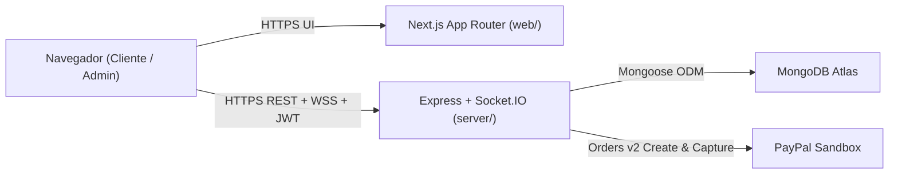
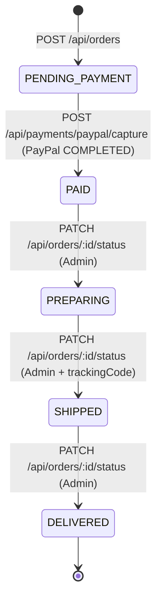

# LibroYa — Comercio Electrónico de Libros Electrónicos, Catálogo/Stock y Envíos en Tiempo Real

Aplicación web full-stack para venta de libros electrónicos (EPUB, PDF, Audiolibro y Edición Impresa + eBook) con gestión de catálogo, control atómico de stock, pasarela de pago **PayPal Sandbox** validada en servidor y tablero **Kanban** de envíos en tiempo real mediante **Socket.IO**.

---

## 1. Objetivo, Actores y Alcance

### Objetivo
Implementar una arquitectura desacoplada y verificable donde el navegador nunca decide precios, autorización ni confirmación de pagos. El backend centraliza las reglas de negocio, persistencia en MongoDB Atlas, comunicación con PayPal Sandbox y difusión segura de eventos WebSocket.

### Actores
- **Visitante:** Consulta catálogo público, filtros por categoría/formato/disponibilidad, detalles de cada título y carrito local.
- **Cliente (`cliente`):** Se registra e inicia sesión; confirma dirección y método de envío; paga mediante PayPal Sandbox; consulta exclusivamente su historial de pedidos, certificados de licencia digital y seguimiento de envíos en vivo.
- **Administrador (`administrador`):** Administra el catálogo (creación, edición, pausado, eliminación y ajuste de stock en vivo) y gestiona el ciclo logístico en el tablero Kanban (`Pendiente` → `En preparación` → `Enviado` → `Entregado`).

---

## 2. Arquitectura del Sistema

```text
Navegador (Cliente / Administrador)
  |
  +---- HTTPS ------------------> Next.js 15 App Router (web/ · :3000)
  |                               (Solo UI; sin API routes ni secretos)
  |
  +---- HTTPS/REST + WSS -------> Node.js + Express + Socket.IO (server/ · :4000)
                                    |
                                    +---- Mongoose ---------> MongoDB Atlas
                                    |
                                    +---- HTTPS REST v2 ----> PayPal Sandbox API
```



### Justificación de decisiones técnicas
1. **Backend separado (`server/`) frente a API routes en Next.js:** Permite alojar las API REST y Socket.IO en un único proceso persistente con estado de conexión WebSocket y facilita desplegar frontend y backend independientemente en Railway.
2. **Límites de confianza estrictos:** El frontend envía únicamente `{ bookId, quantity }` y `shippingMethod`. El backend recalcula importes desde MongoDB, valida disponibilidad/stock y confirma la captura directamente con PayPal Sandbox antes de pasar el pedido a `PAID` y descontar stock.
3. **Autenticación por JWT (`Bearer` + cookie `httpOnly`):** Garantiza compatibilidad tanto en desarrollo local como entre subdominios distintos en Railway (`*.up.railway.app`) evitando fallos por bloqueo de cookies de terceros, mientras protege el handshake de Socket.IO.
4. **Descuento atómico e idempotencia:** Las capturas repetidas de PayPal devuelven el resultado ya registrado sin duplicar cobros ni restar inventario dos veces; el descuento de inventario usa filtros atómicos `stock: { $gte: quantity }` con rollback si falla cualquier ítem del lote.

---

## 3. Modelos de Datos y Máquina de Estados

### Colecciones en MongoDB (`libroya`)
| Colección | Campos principales | Reglas e invariantes |
|---|---|---|
| `users` | `name`, `email`, `passwordHash`, `role`, `timestamps` | `role ∈ {cliente, administrador}`; registro público fuerza `cliente`; `passwordHash` con `bcrypt` y `select: false`. |
| `books` | `title`, `author`, `isbn`, `description`, `category`, `format`, `price`, `stock`, `available`, `coverUrl`, `pages`, `language`, `publishedYear` | `price > 0`; `stock` entero `>= 0`; índice en `{ category, format, available }`. |
| `orders` | `orderNumber`, `userId`, `items[]`, `shippingAddress`, `shippingMethod`, `shippingCost`, `trackingCode`, `subtotal`, `total`, `status`, `paymentStatus`, `paypalOrderId`, `paidAt`, `shippedAt`, `deliveredAt` | `items` guarda snapshot del precio unitario; `total` recalculado en servidor. |
| `payments` | `orderId`, `userId`, `provider`, `providerOrderId`, `captureId`, `amount`, `currency`, `status`, `payerEmail` | Nunca almacena datos de tarjeta; `providerOrderId` y `captureId` con índice único disperso contra duplicados. |

### Máquina de Estados de Pedidos y Envíos



- **Regla de transición:** La máquina de estados (`server/src/services/orderStateMachine.ts`) impide mover pedidos no pagados (`PENDING_PAYMENT`) o saltar etapas (ej. `PAID -> DELIVERED`).

---

## 4. Endpoints REST y Eventos WebSocket

### API REST (`server/`)
| Método y Ruta | Propósito | Acceso / Reglas |
|---|---|---|
| `GET /health` | Estado del servicio y conexión a MongoDB | Público; no expone configuración sensible |
| `POST /api/auth/register` | Registrar nuevo usuario | Público (rate-limited); fuerza rol `cliente` |
| `POST /api/auth/login` | Iniciar sesión y emitir JWT | Público (rate-limited); error genérico `401` |
| `POST /api/auth/logout` | Limpiar cookie de sesión | Público |
| `GET /api/auth/me` | Obtener perfil autenticado | Autenticado (`401` sin JWT) |
| `GET /api/books` | Consultar catálogo con filtros | Público (`category`, `format`, `search`, `inStock`) |
| `GET /api/books/:id` | Detalle de un libro | Público |
| `POST /api/books` | Crear libro en catálogo | Solo `administrador` (`403` para clientes) |
| `PATCH /api/books/:id` | Actualizar datos/precio/disponibilidad | Solo `administrador`; emite `stock:updated` |
| `PATCH /api/books/:id/stock` | Ajustar inventario (`stock` o `delta`) | Solo `administrador`; rechaza stock `< 0`; emite `stock:updated` |
| `DELETE /api/books/:id` | Eliminar libro del catálogo | Solo `administrador` |
| `POST /api/orders` | Crear pedido `PENDING_PAYMENT` | Autenticado; recalcula subtotal/envío/total y valida stock |
| `GET /api/orders/me` | Historial del usuario autenticado | Autenticado; filtra por `userId === req.user.id` |
| `GET /api/orders` | Listar pedidos para Kanban | Solo `administrador` |
| `GET /api/orders/:id` | Consultar detalle de un pedido | Propietario del pedido o `administrador` (`403` otros) |
| `PATCH /api/orders/:id/status` | Avanzar estado en Kanban | Solo `administrador`; aplica máquina de estados y emite WS |
| `POST /api/payments/paypal/order` | Crear orden en PayPal Sandbox | Cliente propietario del pedido; valida stock |
| `POST /api/payments/paypal/capture` | Capturar pago, validar importe/idempotencia y descontar stock | Cliente propietario del pedido |
| `POST /api/payments/paypal/cancel` | Registrar cancelación sin duplicar pedido | Cliente propietario del pedido |

### Eventos Socket.IO (`server/src/socket/io.ts`)
El servidor valida el JWT en el handshake (`auth.token`, header `Authorization` o cookie) y asigna salas del lado servidor (`user:<id>` para cada usuario y `admin:shipments` únicamente si `role === "administrador"`):
- `order:created` → enviado a `admin:shipments` cuando un pago se captura exitosamente.
- `order:statusChanged` → enviado a `admin:shipments` y `user:<ownerId>` ante cambios válidos en el Kanban.
- `order:updated` → enviado a `user:<ownerId>` para actualizar su historial en tiempo real (sin difundir direcciones ni PII a terceros).
- `stock:updated` → emitido ante cambios o compras confirmadas con `{ bookId, stock, available }`.

---

## 5. Ejecución Local y Pruebas

### Requisitos
- Node.js 20+ (probado con v24.12.0) y npm
- Clúster MongoDB Atlas (URI configurada en `server/.env`)
- Credenciales PayPal Sandbox (`Client ID` y `Secret`)

### Configuración de Variables de Entorno
1. Copia las plantillas sin secretos:
   - `server/.env.example` → `server/.env`
   - `web/.env.example` → `web/.env.local`
2. Nunca publiques `MONGODB_URI`, `JWT_SECRET` ni `PAYPAL_CLIENT_SECRET` en `web/.env.local` ni en variables `NEXT_PUBLIC_*`.

### Comandos principales (desde la raíz `lab5/`)
```powershell
# Instalar dependencias (raíz, backend y frontend)
npm install
npm --prefix server install
npm --prefix web install

# Poblar catálogo, usuarios demo y pedidos iniciales en MongoDB Atlas
npm run seed

# Ejecutar pruebas automatizadas (Vitest + Supertest + Socket.IO + MongoMemoryServer)
npm test

# Compilar backend y frontend para producción
npm run build

# Levantar API (:4000) y Web (:3000) en desarrollo
npm run dev
```

### Cuentas de prueba creadas por `npm run seed`
- **Cliente:** `cliente@libroya.com` / `Cliente123!`
- **Administrador:** `admin@libroya.com` / `Admin123!`

---

## 6. Despliegue en Railway (Dos Servicios)

1. Crea un proyecto en [Railway](https://railway.com/) conectado al repositorio GitHub `Santiagox01/lab5`.
2. **Servicio 1 — Backend (`server`):**
   - **Root Directory:** `/server`
   - **Build Command:** `npm install && npm run build` (detectado en `server/railway.json`)
   - **Start Command:** `npm start`
   - **Healthcheck Path:** `/health`
   - **Variables de entorno:**
     - `NODE_ENV=production`
     - `MONGODB_URI=<tu-uri-de-mongodb-atlas>`
     - `JWT_SECRET=<secreto-aleatorio-de-64-caracteres>`
     - `CLIENT_ORIGIN=https://<tu-frontend>.up.railway.app`
     - `PAYPAL_CLIENT_ID=<sandbox-client-id>`
     - `PAYPAL_CLIENT_SECRET=<sandbox-client-secret>`
     - `PAYPAL_API_BASE=https://api-m.sandbox.paypal.com`
   - Genera el dominio público del backend y verifica `https://<tu-backend>.up.railway.app/health`.
3. **Servicio 2 — Frontend (`web`):**
   - **Root Directory:** `/web`
   - **Build Command:** `npm install && npm run build` (detectado en `web/railway.json`)
   - **Start Command:** `npm start`
   - **Variables de entorno (solo públicas):**
     - `NEXT_PUBLIC_API_URL=https://<tu-backend>.up.railway.app`
     - `NEXT_PUBLIC_PAYPAL_CLIENT_ID=<sandbox-client-id>`
4. Asegúrate de que `CLIENT_ORIGIN` en el servicio `server` coincida exactamente con la URL HTTPS del servicio `web` (sin barra diagonal final) y que MongoDB Atlas permita acceso desde la red de Railway.

---

## 7. Auditoría de Seguridad Aplicada
- **Cero secretos en frontend o repositorio:** `PAYPAL_CLIENT_SECRET`, `MONGODB_URI` y `JWT_SECRET` residen exclusivamente en `server/.env` (excluido en `.gitignore`).
- **Prevención de escalada de privilegios:** `POST /api/auth/register` ignora cualquier `role` enviado en el body y asigna `cliente`.
- **Anti-manipulación de importes:** `POST /api/orders` recalcula precios desde MongoDB y `POST /api/payments/paypal/capture` valida estado `COMPLETED`, moneda `USD`, `custom_id` e importe exacto antes de descontar stock.
- **Autorización por rol y propiedad:** Todas las rutas administrativas exigen `requireRole('administrador')`; las consultas y pagos de pedidos exigen `order.userId === req.user.id`.
- **Protección contra abusos:** `helmet`, CORS restringido a `CLIENT_ORIGIN`, `express-rate-limit` en login/registro y sanitización de expresiones regulares en búsquedas del catálogo.
